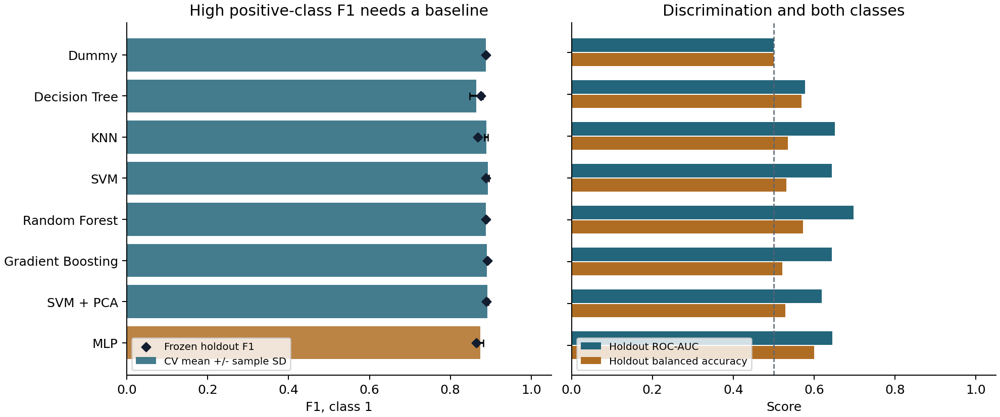
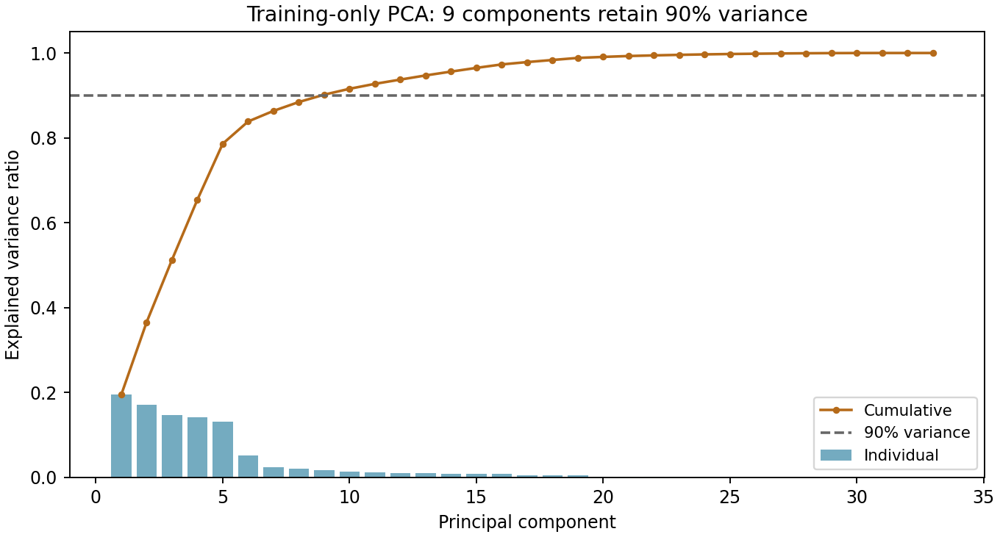
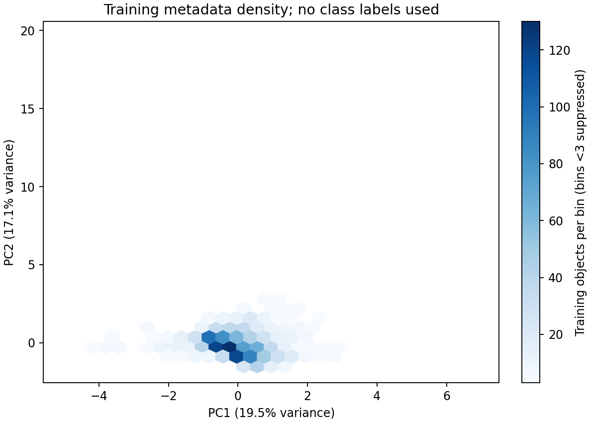
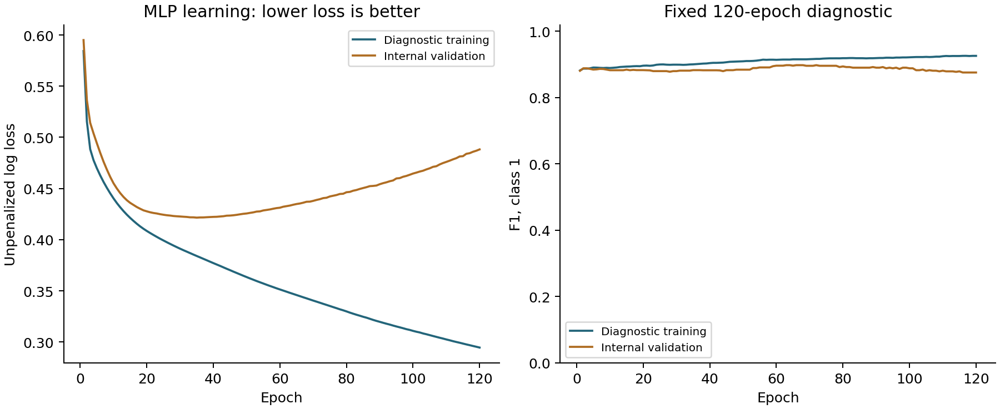
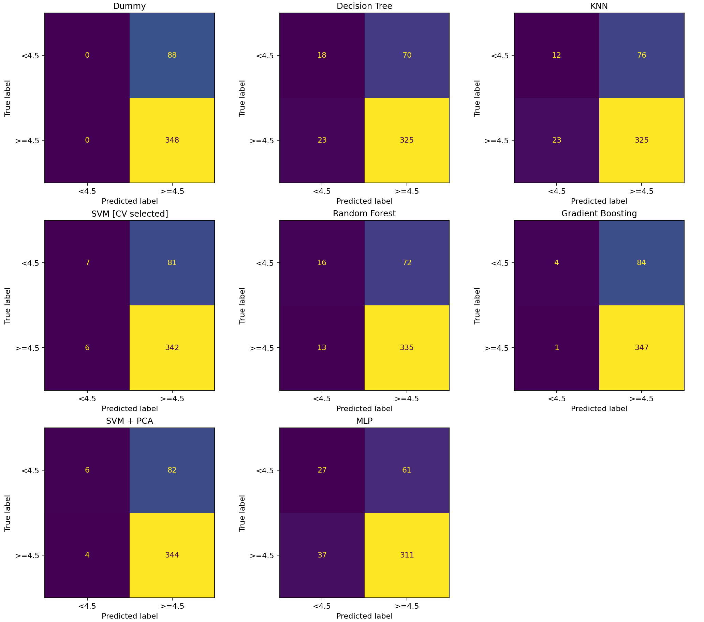

# App Store ratings: Endterm study
01 / Research question, evidence and continuity

Students: Nurtilek Koblandy; Erkebulan Zhuparbay; Mansur Ryskali. Group: SE-2423.

**CONTINUITY GAP - The original Midterm raw data and saved split are unavailable. This report is a separately collected experiment. Every model below uses the same new frozen split, but none of these comparisons establishes improvement on the original Midterm holdout. Criterion 1's same-data/split requirement remains unfulfilled. No instructor exception is claimed.**

Research question: can seven metadata attributes distinguish existing US App Store apps rated at least 4.5 from lower-rated apps, among apps with at least 50 user ratings? The target describes the collection snapshot. It does not measure pre-launch success or establish causality.

| Study property | Observed record |
| --- | --- |
| Eligible real apps | 2,179; class 1: 1,739 (79.8%); class 0: 440 |
| Saved partition | 1,743 training / 436 test; stratified 80/20; seed 42 |
| Eligible-record timestamps, UTC | 2026-11-07T21:10:17.817609+00:00 to 2026-11-07T21:11:17.899026+00:00 |
| Source responses | 18 checksummed API JSON responses |
| Raw rows / deduplicated exclusions | 2,944 rows; 293 duplicate observations removed |
| Experiment | endterm-2026-11-08 |

The training-CV rule selected SVM. Its holdout F1 is 0.8872, versus 0.8878 for the majority baseline (difference -0.0006). ROC-AUC is 0.6433; balanced accuracy is 0.5312. It identifies 7/88 lower-rated apps. These are descriptive results, not a statistical-significance claim.

The Endterm extension adds nested ensemble tuning, training-only PCA, a fold-local PCA ablation, MLP learning diagnostics, complete cross-model errors and a persistent private snapshot. Code and aggregate artifacts are reviewable; human contributions and defense performance remain the students' responsibility.

# Seven inputs, one protected holdout
02 / Features, preprocessing and evaluation protocol

| Permitted model input | Definition | Missing rows |
| --- | --- | --- |
| price_usd | Price in US dollars | 0 |
| size_mb | File size in decimal MB | 0 |
| language_count | Distinct supported-language count | 0 |
| release_year | Original release year | 0 |
| update_recency_days | Full days since latest update at collection time | 0 |
| primary_genre | Primary app category | 0 |
| content_advisory_rating | Age-suitability category; not a user rating | 0 |

averageUserRating creates class 1 at >=4.5; integer userRatingCount >=50 is an eligibility filter. Ratings, rating counts, IDs, app names, developer IDs, descriptions and all other text are excluded from model inputs. Latest observations are deduplicated by trackId before eligibility filtering.

Numeric features receive training-fold median imputation and standardization; an entirely missing training column is retained with zero imputation. Categorical values receive a Missing category and one-hot encoding; unseen categories are ignored. The imputer, encoder and scaler are inside every pipeline. PCA used for prediction is also fitted within each training fold.

All models share the identical five stratified outer folds inside training. Random forest and boosting use three inner folds to choose settings, then score the unseen outer fold. Final ensemble settings use a fresh three-fold search on all training rows. The holdout is evaluated after the selection rule is frozen. No threshold tuning, test-guided preprocessing or test-based reselection occurs.

F1 for class 1 preserves the Midterm decision criterion and balances precision with recall for high-rated apps. The majority-positive distribution makes this score forgiving of missed class-0 apps. ROC-AUC, balanced accuracy, specificity and both confusion-matrix rows therefore remain essential. CV spread is sample standard deviation across five folds, not a confidence interval. SVM ROC-AUC uses decision scores, which are not calibrated probabilities.

# Tuned ensembles with honest CV
03 / Search choices and the earlier-model reference

Random forest averages 100 decorrelated trees. Its search varies depth, leaf size and feature subsampling to control complexity and diversity. Gradient boosting adds small decision trees sequentially; its search trades learning rate against the number and depth of trees. These compact spaces were fixed before the holdout was evaluated and are feasible for this sample size.

| Ensemble | Prespecified search space | Candidates |
| --- | --- | --- |
| Random Forest | max_depth: [None, 12]; min_samples_leaf: [2, 10]; max_features: ['sqrt', 0.8] | 8 |
| Gradient Boosting | n_estimators: [75, 150]; learning_rate: [0.03, 0.1]; max_depth: [1, 2] | 8 |

Each of eight candidates is evaluated on three inner folds within each of five outer folds. A separate full-training search chooses the final refit. Candidate search scores are tuning evidence; the outer scores provide the model comparison. Ties within a search use deterministic parameter order; the final model-family tie-break is alphabetical name.

| Ensemble | Selected full-training settings |
| --- | --- |
| Random Forest | max_depth=None; max_features=sqrt; min_samples_leaf=2 |
| Gradient Boosting | learning_rate=0.03; max_depth=2; n_estimators=75 |

| Model | Outer CV F1 +/- SD | Test F1 | Test F1 minus SVM |
| --- | --- | --- | --- |
| SVM | 0.8926 +/- 0.0031 | 0.8872 | +0.0000 |
| Random Forest | 0.8882 +/- 0.0025 | 0.8874 | +0.0003 |
| Gradient Boosting | 0.8903 +/- 0.0016 | 0.8909 | +0.0037 |

The earlier fixed models are majority Dummy; Decision Tree (depth 8, minimum leaf 10); distance-weighted KNN (k=15); and RBF SVM (C=1, gamma=scale). The original Midterm selected SVM. All four are rerun on this new snapshot; their results must not be conflated with the original experiment.

The complete candidate-level means, sample SDs and ranks are in reports/tuning_results.csv. Selected parameters and outer-fold scores are also retained. A winning outer-CV mean may still be optimistic because the same outer scores choose a model family.

# Every model on the same rows
04 / Combined performance comparison

Selection is based on training outer-CV F1: SVM. Test columns are reported after selection and do not change that choice. All eight models share the same frozen holdout. Only the ensemble rows use inner tuning; all other settings are fixed.

| Model | CV F1 +/- SD | Test F1 | AUC | Prec. | Recall | Bal. acc. | Spec. |
| --- | --- | --- | --- | --- | --- | --- | --- |
| Dummy | 0.888 +/- 0.001 | 0.888 | 0.500 | 0.798 | 1.000 | 0.500 | 0.000 |
| Decision Tree | 0.864 +/- 0.017 | 0.875 | 0.577 | 0.823 | 0.934 | 0.569 | 0.205 |
| KNN | 0.889 +/- 0.004 | 0.868 | 0.651 | 0.810 | 0.934 | 0.535 | 0.136 |
| SVM | 0.893 +/- 0.003 | 0.887 | 0.643 | 0.809 | 0.983 | 0.531 | 0.080 |
| Random Forest | 0.888 +/- 0.002 | 0.887 | 0.698 | 0.823 | 0.963 | 0.572 | 0.182 |
| Gradient Boosting | 0.890 +/- 0.002 | 0.891 | 0.644 | 0.805 | 0.997 | 0.521 | 0.045 |
| SVM + PCA | 0.892 +/- 0.002 | 0.889 | 0.619 | 0.808 | 0.989 | 0.528 | 0.068 |
| MLP | 0.875 +/- 0.007 | 0.864 | 0.645 | 0.836 | 0.894 | 0.600 | 0.307 |

Precision is the fraction of predicted high-rated apps that are truly class 1. Recall is the fraction of high-rated apps detected. Specificity is recall for lower-rated apps. Balanced accuracy averages recall and specificity. These complementary views reveal trade-offs that positive-class F1 alone conceals.

Paired test differences are descriptive. There is one convenience sample and one holdout, without an independent external validation cohort or a prespecified significance test. Small ranking changes are not evidence of reliable general superiority.

# What varies in app metadata?
05 / Training-only PCA and its predictive check

PCA uses full SVD on 1,743 training objects and 33 transformed columns. Numeric columns are standardized; one-hot categories stay at 0/1, so category prevalence influences their contribution. Labels and holdout rows are not used to fit this descriptive projection.

PC1 explains 19.5% and PC2 17.1% of training variance. The first two together explain 36.6%; 9 components are required for 90%. Explained variance assesses information retained, not natural-group stability.

| Direction | Largest signed loadings (top three by magnitude) | Loading |
| --- | --- | --- |
| PC1 | size_mb | +0.606 |
| PC1 | update_recency_days | -0.543 |
| PC1 | release_year | +0.465 |
| PC2 | language_count | +0.624 |
| PC2 | price_usd | +0.597 |
| PC2 | release_year | -0.494 |

The lowest versus highest PC1 quartiles have median sizes of 105.7 versus 382.6 MB, release years 2013 versus 2022, and update ages 136 versus 9 days. This gives the direction an observable metadata interpretation rather than treating a plotted separation as a discovered app category.

Actual training objects, reported coarsely: Lower PC1 example: size in training middle half; update recency in training middle half; Upper PC1 example: size in training upper quartile; update recency in training middle half. PC1 quartile median profiles are saved in reports/pca_profiles.csv. Component signs are arbitrary; the density map does not prove categories, causation or distinct clusters.

Predictive connection: fold-local 90%-variance PCA changes SVM CV F1 by -0.0007 and test F1 by +0.0017. That pipeline refits its own PCA inside every fold; it does not reuse the full-training visualization. Variance preservation can discard low-variance rating signals, and outliers can dominate directions.

# MLP: check learning before claims
06 / Architecture, internal validation and fair reference

The MLP has two hidden layers (32 and 16 ReLU units), a binary output, Adam optimization, learning rate 0.001, L2 alpha 0.001, batch size 64 and a fixed 120-epoch budget. It uses the same seven inputs and fold-local preprocessing as other models. No architecture, epoch or threshold search is performed.

The diagnostic split is entirely inside training: 1,394 learning objects and 349 validation objects. Its imputer/scaler/encoder is fitted only on the learning subset. Curves diagnose the fixed recipe; the best observed epoch is not used to change settings. CV then independently fits the fixed recipe in every outer training fold.

The final validation loss is 0.4882, versus training loss 0.2946 (gap +0.1936). Validation loss changed by +0.0110 over the last 10 recorded epochs. Its minimum was at epoch 35, 0.0667 below the final value. The late validation deterioration is consistent with overfitting. Reaching 120 iterations is not a mathematical convergence guarantee. Full fold/refit convergence warnings are retained in model_selection.json.

| Reference chosen using CV | CV F1 +/- SD | Test F1 | Test AUC |
| --- | --- | --- | --- |
| SVM | 0.8926 +/- 0.0031 | 0.8872 | 0.6433 |
| MLP | 0.8746 +/- 0.0069 | 0.8639 | 0.6449 |

Relative to the best earlier non-MLP model, MLP CV F1 differs by -0.0180; test F1 differs by -0.0233. A neural network is not inherently better for this small tabular task. Its flexibility, finite optimization budget and the limited information in metadata can all affect performance; no causal explanation is established.

# Confusion matrices expose the trade-off
07 / Frozen-holdout errors for every model

Rows are true classes and columns are predictions. Class 0 is rating <4.5; class 1 is rating >=4.5. False positives are lower-rated apps called high-rated. False negatives are high-rated apps called lower-rated. Matrix entries are exact aggregate counts on the common holdout.

The selected SVM model makes 81 false positives and 6 false negatives. The majority Dummy makes 88 false positives and 0 false negatives. Positive-class F1 must be interpreted alongside these counts; the majority classifier can score highly while never recognizing a lower-rated app.

# Real errors, anonymized for publication
08 / Actual examples across all eight models

Examples are real held-out errors, selected within each model/error type by distance from the 4.5 boundary, then ID. At most two per error type are saved; one per type is summarized here. Quartiles are computed on training data. Exact ratings, IDs, names, descriptions and input vectors remain private.

| Model | All errors | Coarse observations from actual held-out errors |
| --- | --- | --- |
| Dummy | FP 88
FN 0 | FP: size in training upper quartile; update recency in training middle half; true rating lies within 0.1 of the target boundary; FN: no such error occurred on this holdout |
| Decision Tree | FP 70
FN 23 | FP: size in training upper quartile; update recency in training middle half; true rating lies within 0.1 of the target boundary; FN: size in training middle half; update recency in training middle half; true rating lies within 0.1 of the target boundary |
| KNN | FP 76
FN 23 | FP: size in training upper quartile; update recency in training middle half; true rating lies within 0.1 of the target boundary; FN: size in training upper quartile; update recency in training middle half; true rating lies within 0.1 of the target boundary |
| SVM | FP 81
FN 6 | FP: size in training upper quartile; update recency in training middle half; true rating lies within 0.1 of the target boundary; FN: size in training lower quartile; update recency in training upper quartile; true rating lies within 0.1 of the target boundary |
| Random Forest | FP 72
FN 13 | FP: size in training upper quartile; update recency in training middle half; true rating lies within 0.1 of the target boundary; FN: size in training lower quartile; update recency in training upper quartile; true rating lies within 0.1 of the target boundary |
| Gradient Boosting | FP 84
FN 1 | FP: size in training upper quartile; update recency in training middle half; true rating lies within 0.1 of the target boundary; FN: size in training lower quartile; update recency in training upper quartile |
| SVM + PCA | FP 82
FN 4 | FP: size in training upper quartile; update recency in training middle half; true rating lies within 0.1 of the target boundary; FN: size in training lower quartile; update recency in training upper quartile; true rating lies within 0.1 of the target boundary |
| MLP | FP 61
FN 37 | FP: size in training upper quartile; update recency in training middle half; true rating lies within 0.1 of the target boundary; FN: size in training upper quartile; update recency in training middle half; true rating lies within 0.1 of the target boundary |

These observations locate cases where metadata prediction fails. They do not explain why users gave a rating or why a model made an individual error. Borderline labels may be unstable as ratings change, and the size/update summaries cannot capture usability, bugs or user expectations. The full anonymized case table is reports/error_cases_anonymized.csv; detailed predictions stay private.

# Where the models disagree
09 / Paired comparisons, model trade-offs and error cohorts

Each paired count compares predictions on the same app. Model-only correct means the candidate fixes an SVM error; SVM-only correct means it introduces an error where SVM was right. These counts characterize trade-offs, not statistical significance.

| Model vs SVM | Model only correct | SVM only correct | Both wrong | Disagreements |
| --- | --- | --- | --- | --- |
| Dummy | 6 | 7 | 81 | 13 |
| Decision Tree | 17 | 23 | 70 | 40 |
| KNN | 7 | 19 | 80 | 26 |
| SVM | 0 | 0 | 87 | 0 |
| Random Forest | 12 | 10 | 75 | 22 |
| Gradient Boosting | 5 | 3 | 82 | 8 |
| SVM + PCA | 3 | 2 | 84 | 5 |
| MLP | 22 | 33 | 65 | 55 |

Dummy: 88 FP and 0 FN; precision 0.798, recall 1.000, specificity 0.000. Training-minus-CV F1 gap -0.000.

Decision Tree: 70 FP and 23 FN; precision 0.823, recall 0.934, specificity 0.205. Training-minus-CV F1 gap +0.038.

KNN: 76 FP and 23 FN; precision 0.810, recall 0.934, specificity 0.136. Training-minus-CV F1 gap +0.111.

SVM: 81 FP and 6 FN; precision 0.809, recall 0.983, specificity 0.080. Training-minus-CV F1 gap +0.006.

Random Forest: 72 FP and 13 FN; precision 0.823, recall 0.963, specificity 0.182. Training-minus-CV F1 gap +0.016.

Gradient Boosting: 84 FP and 1 FN; precision 0.805, recall 0.997, specificity 0.045. Training-minus-CV F1 gap +0.002.

SVM + PCA: 82 FP and 4 FN; precision 0.808, recall 0.989, specificity 0.068. Training-minus-CV F1 gap +0.004.

MLP: 61 FP and 37 FN; precision 0.836, recall 0.894, specificity 0.307. Training-minus-CV F1 gap +0.050.

The baseline detects 0 lower-rated apps. Relative to SVM, Decision Tree changes FP/FN counts by -11/+17, and KNN by -5/+17. KNN's training F1 is 1.000, with a 0.111 CV gap: fitting the training sample well does not ensure generalization. Random Forest AUC is 0.698, versus SVM 0.643. The prespecified F1 rule does not select by AUC; this is not a reason to reselect after the test.

Gradient Boosting misses only 1 positive app(s), while recognizing just 4 lower-rated app(s). PCA changes 5 SVM predictions, with CV F1 difference -0.0007. MLP recognizes 27 class-0 objects but misses 37 positives. Its CV F1 difference from the best earlier reference is -0.0180; the learning curves must be read alongside this trade-off.

Genre-level error rates are reported only for groups of at least 20 held-out apps. For SVM, the highest observed eligible-group error rate is 27.7% in Games (26/94). This is an exploratory, sample-specific association, without a causal claim or multiple-group correction.

Large training-minus-CV gaps suggest fitting variation that does not generalize under this validation design. A smaller gap does not by itself imply strong discrimination: the Dummy can have a near-zero gap while missing every class-0 app. Model selection remains tied to the prespecified F1 rule.

# Conclusions and a feasible Final
10 / Limits tied to the data and a lawful source plan

On this separately collected snapshot, SVM is selected by training CV. Its holdout AUC of 0.643 and balanced accuracy of 0.531 describe how much the seven metadata inputs distinguish the two rating classes. The observed F1 difference from Dummy is -0.0006. This answers a snapshot classification question, not pre-launch prediction, business success or the causes of satisfaction.

What changed since Midterm: two ensembles now have documented nested searches; PCA is both interpreted and tested in a fold-local predictive ablation; MLP learning is checked before comparison; all models have paired errors and minority-class measures; raw data and a checksummed manifest are retained privately. The new snapshot and missing original archive prevent a same-test-set before/after claim.

Limitations: keyword-ranked collection is a convenience sample. The >=50-ratings filter selects established apps. Developer-related apps may cross the random split. Metadata and labels evolve over time, update recency can reflect popularity, and threshold-adjacent labels can change. Class imbalance makes F1 appear strong even when lower-rated apps are missed. No feature captures experienced bugs, usability or expectation mismatch, so coarse error associations are not explanations.

**FINAL SOURCE PLAN - Retained developer description text from the documented iTunes Search API is a candidate source, not an assertion of reuse rights. Review the current source conditions and obtain appropriate permission before text modeling or redistribution. Instructor course approval is not copyright permission and does not override robots.txt or Apple's terms. If permission is unavailable, use an appropriately licensed, app-linked alternative and document its license.**

Linkage and purpose: join approved descriptions to the existing objects using trackId privately. Keep only the same frozen eligible cohort, record text availability and checksums, and report unmatched objects. Descriptions may encode intended functions and use cases absent from seven metadata inputs; they may still omit actual defects and are promotional, so their usefulness is a hypothesis.

Next experiment: prespecify a simple word/character TF-IDF representation with a linear classifier, then compare metadata-only, text-only and combined inputs. Fit vocabulary, weighting and all tuning inside training folds; avoid names, IDs or explicit rating claims as shortcuts. Compare the same metrics, class-0 errors and paired mistakes on matched objects. Because this holdout has now been inspected, use a later untouched, licensed snapshot or a prespecified developer/time holdout for a strong confirmatory Final claim. Any new snapshot is a separate experiment. A local application remains Final scope.

# Reproduce, disclose and defend
11 / Submission evidence, remaining duties and references

Use docs/endterm_run.md for installation and execution, and docs/endterm_changes.md for the change log. The private submission package should preserve raw responses/metadata, cleaned data, saved split, fitted models, predictions and checksums. Public artifacts contain only aggregates. Do not force-add ignored files or publish the private package. The notebook is designed to rerun the pipeline using the saved snapshot; the source code never needs test rows during training.

| Rubric criterion | Evidence / honest status |
| --- | --- |
| 1 / Continuity and fixes | Incomplete: original data/split unavailable. New snapshot, change log and checksums retained. |
| 2 / Ensembles | RF and boosting search spaces, nested CV, selected settings and SVM comparison. |
| 3 / Unsupervised | Training PCA variance, loadings, actual coarse examples and fold-local SVM ablation. |
| 4 / Neural network | MLP train/validation learning curves, fixed settings and CV-best earlier reference. |
| 5 / Comparison and errors | Eight-model table, confusion matrices, actual anonymized errors and paired counts. |
| 6 / Conclusions and Final | Qualified findings, observed limits and a permission-dependent linked-text plan. |
| 7 / Seven-minute talk | Three named speakers share 420 seconds. Students must rehearse and confirm team-size acceptance. |
| 8 / Individual defense | Names and assigned roles recorded; completed contributions and independent understanding require verification. |

| Student / group SE-2423 | Assigned responsibility (completion unverified) |
| --- | --- |
| Nurtilek Koblandy | Data preparation, provenance, leakage checks and baseline models |
| Erkebulan Zhuparbay | Ensemble tuning, model comparison and PCA analysis |
| Mansur Ryskali | MLP learning checks, error analysis, conclusions and Final plan |

AI disclosure: OpenAI Codex assisted with implementation, analysis, automated checks and English report/presentation drafting. The students must verify all claims, document their actual contributions in docs/contributions.md and explain any part independently. Names were supplied by the owner. Assigned roles are a work plan, not a claim of completed human work. No hours, instructor exception or defense performance have been invented.

The owner listed three students. The rubric describes two partners; instructor acceptance of this team size has not been supplied. All three names are retained without assuming an exception.

Submission: team members use the same complete archive and the rubric's Endterm_Surname_Name_Group.zip naming convention by 23:59 on the day before their defense. The defense date has not been supplied.

References: Endterm Rubric.pdf, supplied by the owner and read for this implementation. Apple Search API: https://performance-partners.apple.com/search-api ; source robots: https://itunes.apple.com/robots.txt . These are source-context references, not a claim of reuse permission.

Method references: https://scikit-learn.org/1.6/modules/cross_validation.html ; https://scikit-learn.org/1.6/modules/grid_search.html ; https://scikit-learn.org/1.6/modules/decomposition.html#pca ; https://scikit-learn.org/1.6/modules/neural_networks_supervised.html . Software versions and source hashes are recorded in reports/environment.txt and reports/source_hashes.json.
